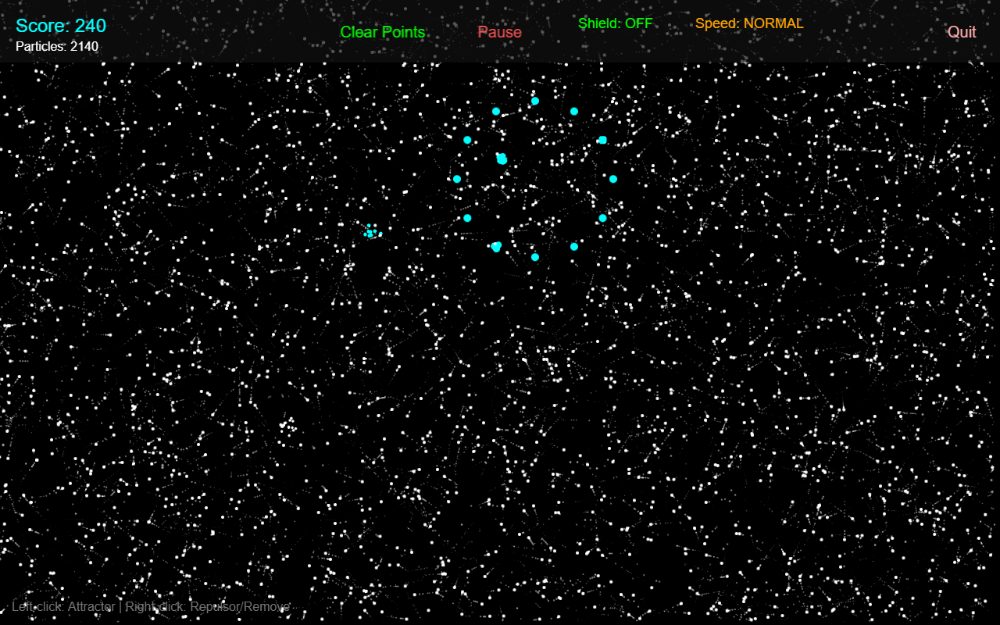
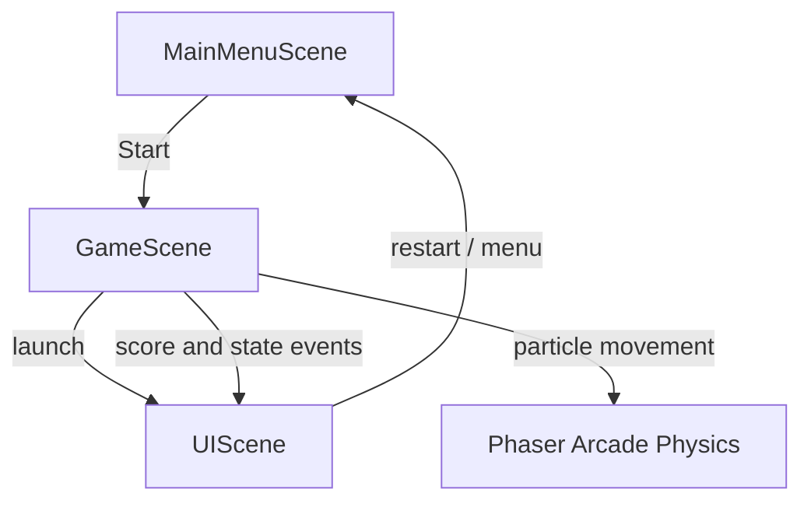

# Particle Swarm

**A browser game about controlling a swarm indirectly through attraction and repulsion fields.**

[](https://phaser.io/)
[](#play-locally)
[](LICENSE)

<p align="center">
  
</p>

> 玩家不直接操控一个角色，而是在场景中布置引力与斥力点，间接引导粒子群收集资源、躲避危险并争取高分。

## Why it is fun to inspect

- **Emergent movement:** hundreds of particles react to a small number of force fields.
- **Indirect control:** left click creates an attractor; right click creates a repulsor or removes one.
- **Resource loop:** collect food, avoid hazards, and use shield/reinforcement power-ups.
- **Scene separation:** menu, simulation, and UI run as independent Phaser scenes.
- **Performance-aware effects:** bounded trail emitters and generated textures avoid large asset files.
- **No build step:** the demo runs from a tiny local static server using vendored Phaser.

## Play locally

```bash
git clone https://github.com/leonryuu29/particle-swarm-game.git
cd particle-swarm-game
node scripts/serve.mjs
```

Open <http://127.0.0.1:4173/>.

No Node package installation is needed just to play. For the browser smoke test:

```bash
npm install
npm test
```

The test launches Microsoft Edge headlessly, clicks **Start Game**, verifies all three
Phaser scenes, and writes a fresh screenshot to `docs/screenshots/gameplay.png`.

## Controls

| Input | Action |
|---|---|
| Left click | Place an attractor |
| Right click | Place a repulsor |
| Right click on an existing field | Remove that field |
| Pause | Pause or resume the simulation |
| Clear Points | Remove every force field |
| Quit | Return to the main menu |

## Architecture



| File | Responsibility |
|---|---|
| `game.js` | Phaser configuration and scene registration |
| `js/scenes/MainMenuScene.js` | Animated menu, generated starfield, high score |
| `js/scenes/GameScene.js` | Particle simulation, food, hazards, power-ups |
| `js/scenes/UIScene.js` | HUD, pause, score, shield timer, game-over panel |
| `scripts/serve.mjs` | Dependency-free static server |
| `tests/smoke.mjs` | Headless Edge smoke test |

## Engineering notes

- The original coursework report is preserved at [`docs/PROJECT_REPORT.docx`](docs/PROJECT_REPORT.docx).
- A readable implementation report is available at [`docs/TECHNICAL_REPORT.md`](docs/TECHNICAL_REPORT.md).
- The menu and game-over screen use the same `localStorage` high-score key.
- The original third-party background track is intentionally not redistributed.
  The game is fully playable without audio.

## Third-party software

Phaser 3 is vendored under its MIT license. See [`vendor/PHASER_LICENSE.md`](vendor/PHASER_LICENSE.md).

## License

Project source is released under the MIT License. See [`LICENSE`](LICENSE).
